

  

<h1 align="center">Moon SI Analyzer</h1>

  A desktop application for Touchstone channel analysis, signal-integrity evaluation, RF characterization, and time-domain visualization.

  
  
  
  

---

## Overview

**Moon SI Analyzer** is a Python desktop tool for exploring the electrical behavior of interconnects and RF networks from Touchstone S-parameter data. It combines frequency-domain plots, time-domain transformations, statistical eye analysis, channel-quality checks, and practical network-processing utilities in one interface.

The application is intended for engineers, students, and hardware developers who need to inspect a channel, understand its loss and impedance behavior, estimate its impact on a digital link, or prepare network data for further simulation.

The main application is implemented in a single Python entry point, <code>si_analyzer.py</code>. Its interface is built with Tkinter, while Matplotlib provides embedded plots. NumPy and SciPy provide numerical and signal-processing operations, and scikit-rf handles Touchstone networks and several RF operations.

> **Analysis note:** Some outputs—particularly the eye diagram, bathtub curves, BER contours, and COM-like channel-quality estimate—are calculated from a model and its configured assumptions. They are useful engineering aids, not a replacement for calibrated measurements, a complete transmitter/receiver simulation, or a standards-compliance test.

## Highlights

- Load and inspect multi-port Touchstone network files.
- View S-parameter magnitude and phase, insertion loss, impedance, and Smith-chart response.
- Reconstruct a statistical eye-density plot from the selected channel's S21 response.
- Explore multiple signaling formats, equalization settings, eye masks, and jitter/noise assumptions.
- Analyze TDR/TDT responses, impedance profiles, group delay, gain, stability, and RF metrics.
- Convert two-port S-parameters to other network parameter representations.
- Inspect mixed-mode behavior in four-port networks.
- Estimate RLGC parameters and fit an equivalent π model.
- Run channel-quality, crosstalk, file-comparison, and batch-analysis workflows.
- Cascade or de-embed two-port networks, apply time gates, and create rational vector-fit models.
- Export plots, CSV data, HTML reports, and reusable JSON analysis sessions.
- Download prebuilt releases for Windows, Linux, and macOS.

## Features and analysis workflow

### 1. Touchstone loading and channel selection

The main loader accepts Touchstone files with at least two ports, including common formats such as <code>.s2p</code>, <code>.s4p</code>, and higher-port-count <code>.sNp</code> files.

- **Two-port networks:** loaded directly as the active channel.
- **Four-port networks:** the application can derive the differential-mode Sdd 2-port block using the selected differential pair assignment. The default pairing is <code>1-2 / 3-4</code>.
- **Other multi-port networks:** a port-mapping dialog is used to select a single-ended input/output pair or a differential four-port mapping.
- **Recent files and sessions:** recently opened paths are remembered, and analysis settings can be saved to and restored from a JSON session file.

The parser validates the frequency vector and S-parameter values. It requires at least three frequency points, a strictly increasing frequency sweep, and finite S-parameter data.

### 2. Core channel views

| View | What it shows |
|---|---|
| Project & Summary | A consolidated channel summary and analysis information. |
| S-parameters | Magnitude and unwrapped phase for S11, S21, S12, and S22. |
| Loss | Forward insertion loss across frequency, including a Nyquist-frequency reference marker. |
| Impedance & Smith | Input impedance derived from S11/S22 and the S11 reflection-coefficient trace on a Smith chart. |
| Eye & Jitter | A two-UI eye-density view reconstructed from the selected channel response, with eye-height, eye-width, and RMS crossing-spread readouts. |

### 3. Statistical eye and equalization

The eye engine generates a synthetic symbol sequence, filters it through the channel response, and accumulates a two-unit-interval voltage/time density histogram. It processes the data in blocks to keep memory use bounded as the symbol count increases.

Available signal formats include:

- NRZ (PAM2), PAM3, PAM4, and PAM8
- RZ with 50% duty cycle
- Manchester
- MLT-3
- Duobinary
- Clock pattern (<code>1010…</code>)
- PRBS7, PRBS9, and PRBS15

The eye-analysis controls include:

- Data rate, signal swing, and number of observed symbols
- Eye-density colormap and oversampling quality
- Automatic or user-specified transmitter rise time
- Three-tap transmit FFE pre-cursor and post-cursor settings
- Receive CTLE boost and peak frequency
- Ideal-decision DFE post-cursor tap count
- Voltage-noise and random-jitter assumptions for the statistical display
- Configurable eye masks, including built-in mask presets

The eye calculation uses the selected channel's S21 response. When source/load terminations are enabled, the transfer response includes the configured source and load reflection coefficients.

### 4. Advanced RF and time-domain analysis

The **Advanced** section contains the following analysis tools:

| Tool | Description |
|---|---|
| TDR / Z-profile | Calculates reflection and transmission step responses, impedance versus time, and the S21 impulse response. Rise time, window function, effective relative permittivity, and displayed time span are configurable. |
| Group delay | Displays transmission and reflection group delay, with a phase-linearity view. |
| Gains & stability | Evaluates power gains for configurable complex source/load impedances and plots stability quantities including Rollett K, determinant Δ, and Edwards–Sinsky μ/μ′. |
| Parameters | Converts a two-port S matrix to Z, Y, ABCD, T, H, and G parameter sets, with selectable presentation formats. |
| RF metrics | Reports and plots VSWR, return loss, passivity, and reciprocity error. |
| Mixed-mode | Converts a four-port single-ended network into Sdd, Sdc, Scd, and Scc blocks for the selected differential-pair ordering. |
| Equivalent circuit | Extracts RLGC-related transmission-line quantities and fits a π-equivalent model using the selected line length and fitting band. |
| Noise | Reads available two-port Touchstone noise parameters and evaluates noise figure and related source-noise quantities. When a noise block is absent, the application labels its passive-channel estimate accordingly. |
| TRL de-embed | Uses Thru, Reflect, Line, and raw DUT measurements to perform a TRL calibration workflow and apply the corrected two-port network. |

### 5. Quality and equalization

The **Quality & EQ** section brings together link-oriented analysis and comparison tools:

- **Pulse / Bathtub:** pulse response after the configured equalization, horizontal and vertical bathtub views, and a BER contour based on the selected noise/jitter assumptions and target BER.
- **Limit lines:** user-entered frequency-versus-limit points for insertion-loss and return-loss checks. The displayed defaults are examples/placeholders; replace them with the applicable specification.
- **ILD / COM / Causality:** insertion-loss deviation, an impulse-response causality view, and a simplified peak-distortion-based COM-like budget.
- **Crosstalk:** victim through response, near-end crosstalk (NEXT), far-end crosstalk (FEXT), and attenuation-to-crosstalk analysis from a loaded N-port network.
- **Compare files:** overlays selected channel metrics for multiple loaded files, including insertion loss, return loss, group delay, and port-1 impedance profile.

The COM-like result is an application-specific simplified estimate. It should not be interpreted as an official IEEE COM result.

### 6. Network utilities

The **Tools** section includes:

- **Cascade / De-embed:** cascade a loaded two-port network with another file, de-embed a file at either port, or flip port orientation.
- **Vector fit / SPICE:** fit a rational pole-residue model, inspect fit error and passivity, optionally enforce passivity, and export a SPICE subcircuit.
- **Time gating:** inspect the time-domain response of S11, S22, S21, or S12; configure the gate interval and edge; keep or remove the selected time region; and apply the result to the active channel.
- **Smith+ / Matching:** inspect source/load stability circles, available-gain circles, and noise circles when noise parameters are available; matching-related calculations are provided in the same view.
- **Conditioning:** inspect the frequency grid and channel traces, resample the network onto a uniform frequency grid, add an extrapolated DC point, enforce reciprocity, and undo the last channel operation.
- **Batch:** queue Touchstone files or a folder, calculate channel metrics, optionally include a lightweight eye estimate, and export the results table to CSV.

### 7. Export and session management

The application can export:

- All available analysis figures to a folder of PNG files
- S-parameter, insertion-loss, and S21 group-delay data to CSV
- A self-contained HTML report containing the channel summary and embedded plot images
- A JSON session containing supported analysis settings and the source-file path

A session stores settings and the path to the channel file; it does not embed the Touchstone file itself. The original data file must remain available at the saved path to restore the complete analysis automatically.

## Visual walkthrough

The screenshots below are grouped by the four folders in <code>images/screenshots/</code>. Each caption identifies the corresponding interface or analysis feature and describes its purpose in the application.

### Basic

<table>
  <tr>
    <td valign="top" width="50%">
      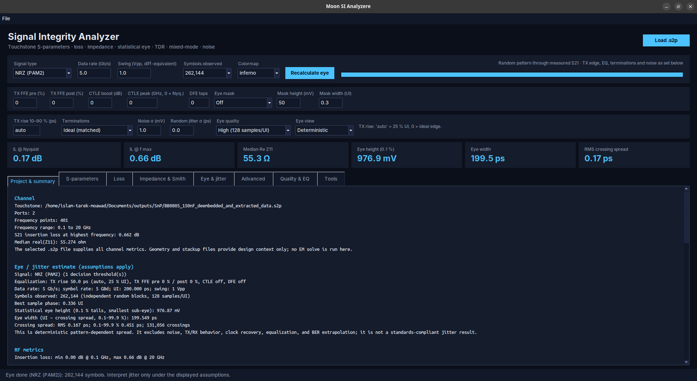
       <strong>Project &amp; Summary</strong> 
      Overview of the loaded channel and a consolidated summary of the current analysis.
    </td>
    <td valign="top" width="50%">
      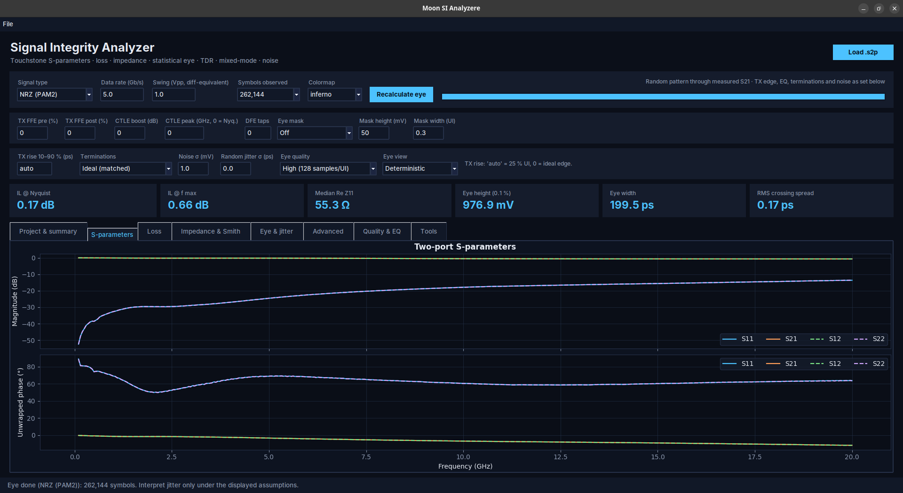
       <strong>S-parameters</strong> 
      Magnitude and phase plots for the two-port reflection and transmission terms S11, S21, S12, and S22.
    </td>
  </tr>
  <tr>
    <td valign="top" width="50%">
      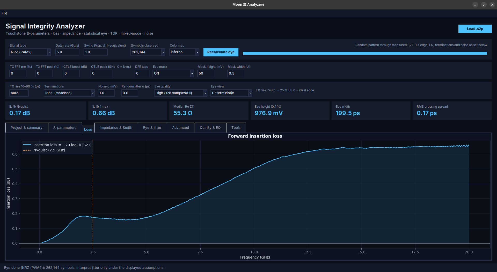
       <strong>Loss</strong> 
      Forward insertion loss versus frequency, with the Nyquist-frequency marker used as a digital-link reference.
    </td>
    <td valign="top" width="50%">
      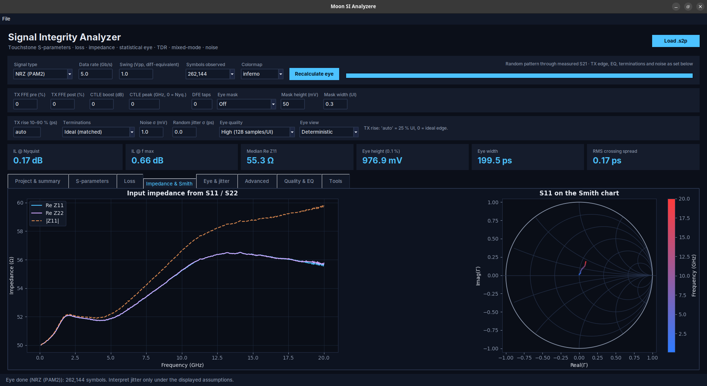
       <strong>Impedance &amp; Smith</strong> 
      Input impedance derived from the reflection responses alongside the S11 trace on a Smith chart.
    </td>
  </tr>
  <tr>
    <td valign="top" width="50%">
      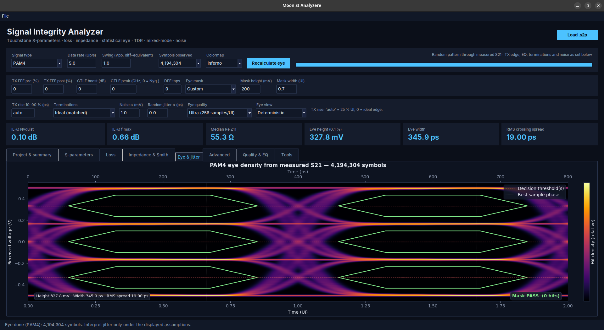
       <strong>Eye &amp; Jitter</strong> 
      Two-UI statistical eye-density reconstruction with eye height, eye width, and RMS crossing-spread metrics.
    </td>
    <td valign="top" width="50%"></td>
  </tr>
</table>

### Advanced

<table>
  <tr>
    <td valign="top" width="50%">
      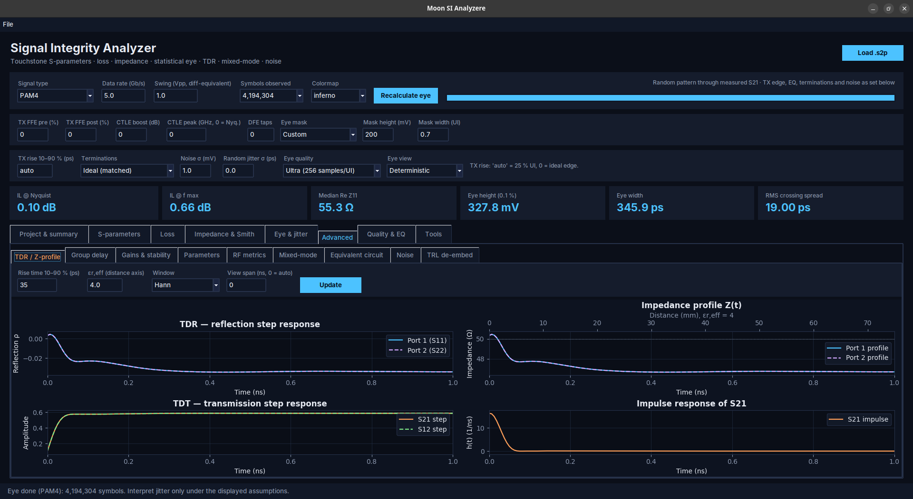
       <strong>TDR / Z-profile</strong> 
      Time-domain reflection and transmission responses, impedance profile, and channel impulse-response information.
    </td>
    <td valign="top" width="50%">
      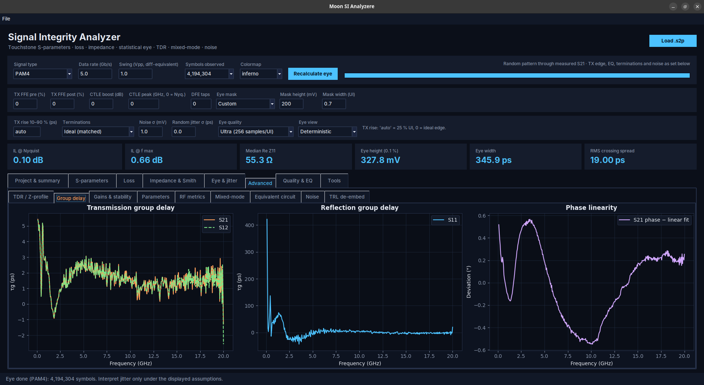
       <strong>Group delay</strong> 
      Transmission and reflection group delay with a phase-linearity view for identifying frequency-dependent delay behavior.
    </td>
  </tr>
  <tr>
    <td valign="top" width="50%">
      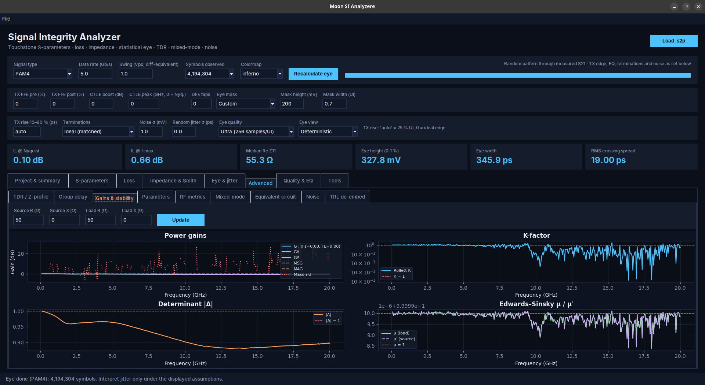
       <strong>Gains &amp; Stability</strong> 
      Power-gain plots and two-port stability indicators, including K-factor, determinant Δ, and μ/μ′.
    </td>
    <td valign="top" width="50%">
      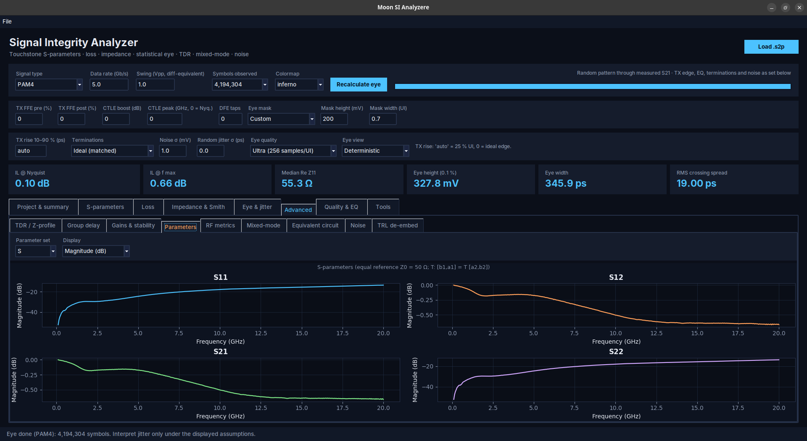
       <strong>Parameters</strong> 
      Frequency-domain conversion of the active two-port network between S, Z, Y, ABCD, T, H, and G representations.
    </td>
  </tr>
  <tr>
    <td valign="top" width="50%">
      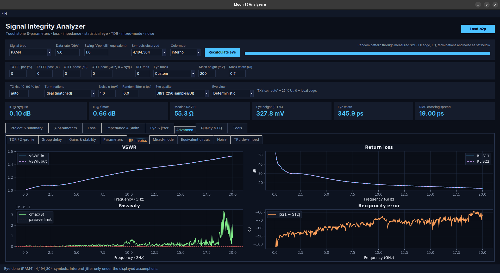
       <strong>RF metrics</strong> 
      VSWR, return-loss, passivity, and reciprocity checks across the channel frequency sweep.
    </td>
    <td valign="top" width="50%">
      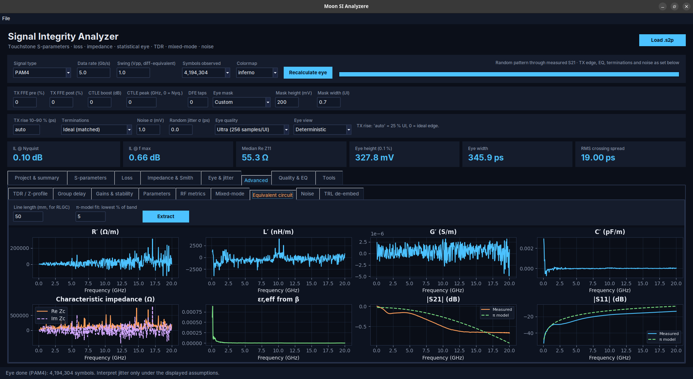
       <strong>Equivalent circuit</strong> 
      Transmission-line RLGC extraction and π-model fitting using the selected line length and frequency range.
    </td>
  </tr>
  <tr>
    <td valign="top" width="50%">
      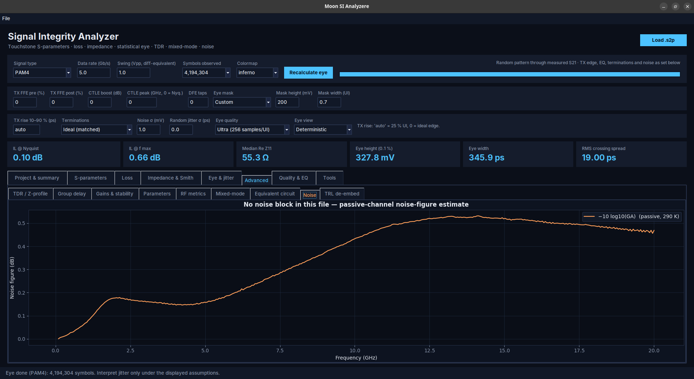
       <strong>Noise</strong> 
      Noise-figure and noise-parameter analysis, including minimum noise figure, optimum source reflection, and equivalent noise resistance where data is available.
    </td>
    <td valign="top" width="50%"></td>
  </tr>
</table>

### Quality and EQ

<table>
  <tr>
    <td valign="top" width="50%">
      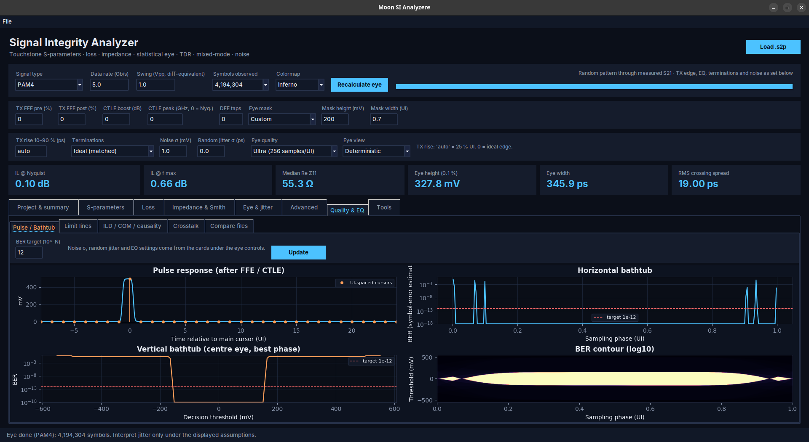
       <strong>Pulse / Bathtub</strong> 
      Equalized pulse response, horizontal and vertical bathtub curves, and a logarithmic BER contour derived from the configured model assumptions.
    </td>
    <td valign="top" width="50%">
      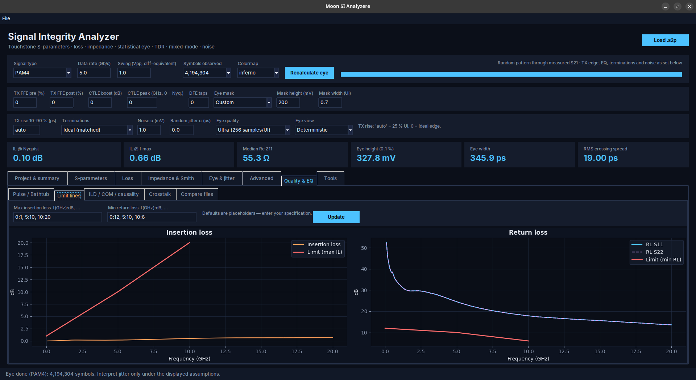
       <strong>Limit lines</strong> 
      User-defined insertion-loss and return-loss limits plotted against frequency for channel-specification checks.
    </td>
  </tr>
  <tr>
    <td valign="top" width="50%">
      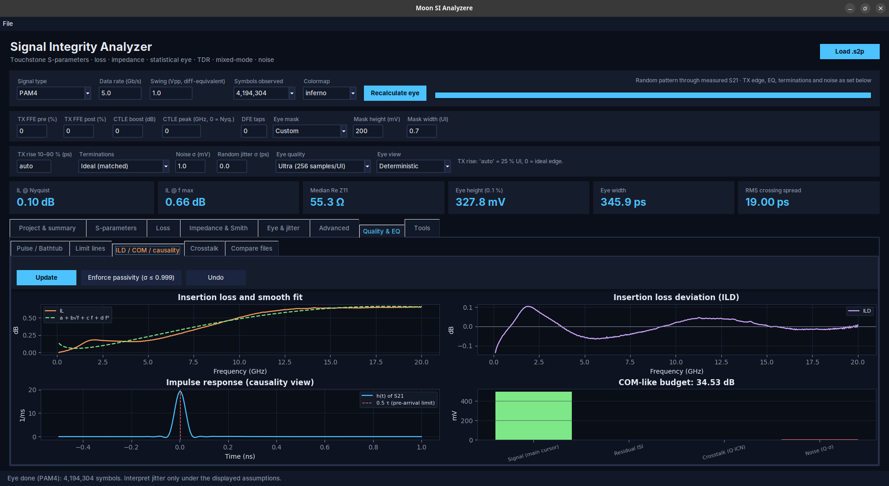
       <strong>ILD / COM / Causality</strong> 
      Insertion-loss deviation, impulse-response causality inspection, and the application's simplified COM-like channel-quality estimate.
    </td>
    <td valign="top" width="50%">
      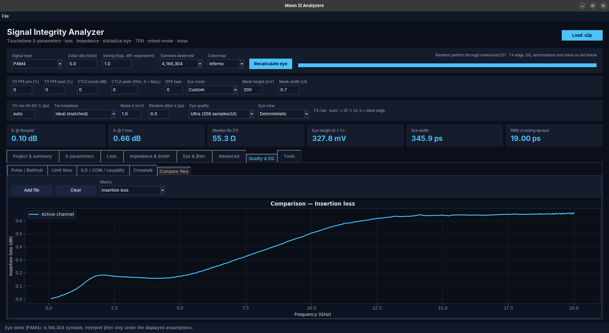
       <strong>Compare files</strong> 
      Overlay selected channel metrics from multiple Touchstone files to compare insertion loss, return loss, group delay, or impedance profile.
    </td>
  </tr>
</table>

### Tools

<table>
  <tr>
    <td valign="top" width="50%">
      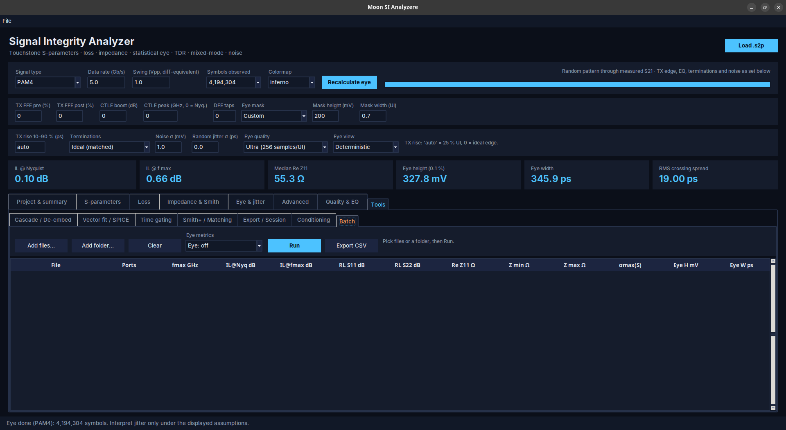
       <strong>Batch</strong> 
      Queue multiple Touchstone files or a folder, calculate channel metrics, optionally add eye estimates, and export the results to CSV.
    </td>
    <td valign="top" width="50%">
      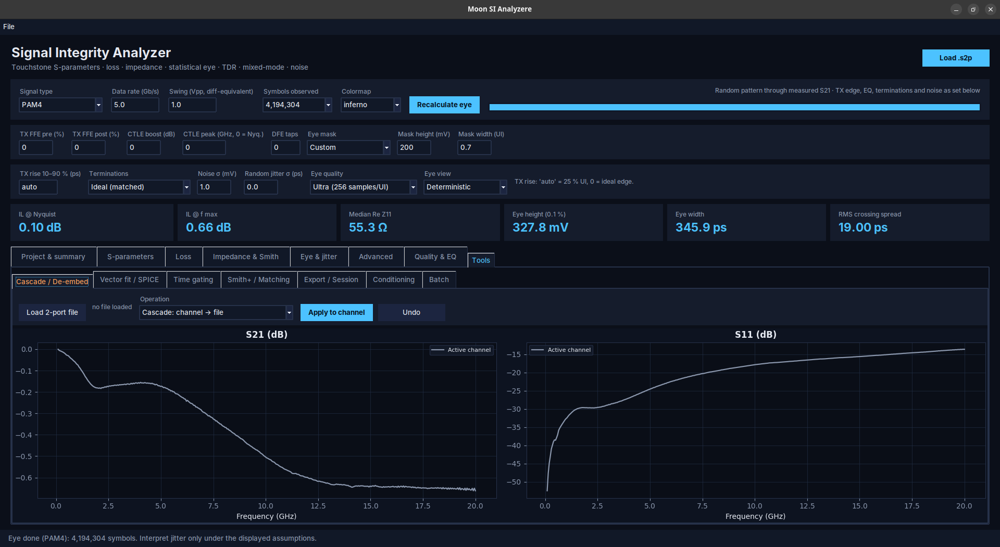
       <strong>Cascade / De-embed</strong> 
      Combine two-port networks, remove a fixture from either side of the channel, or reverse the port orientation.
    </td>
  </tr>
  <tr>
    <td valign="top" width="50%">
      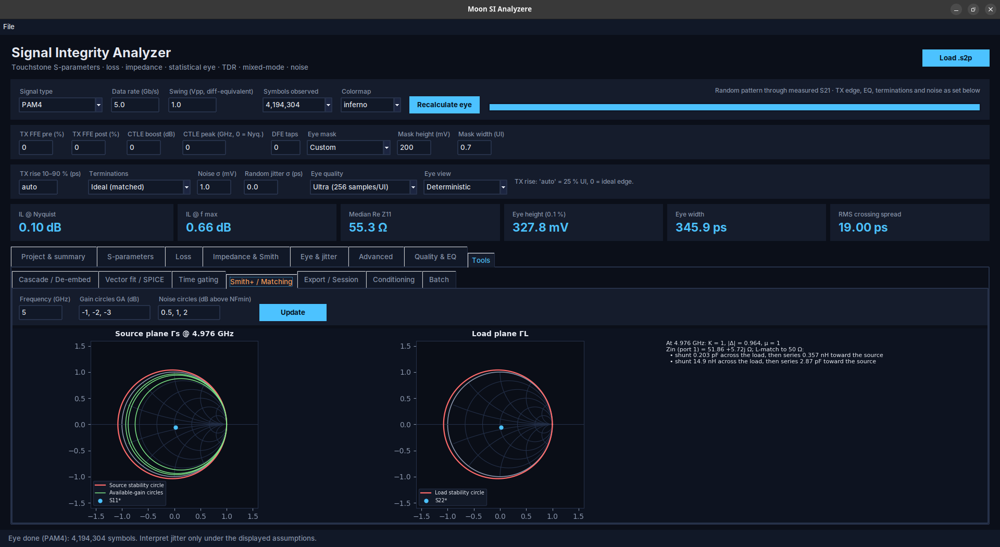
       <strong>Smith+ / Matching</strong> 
      Source and load stability circles, available-gain circles, and noise circles when Touchstone noise data is available.
    </td>
    <td valign="top" width="50%">
      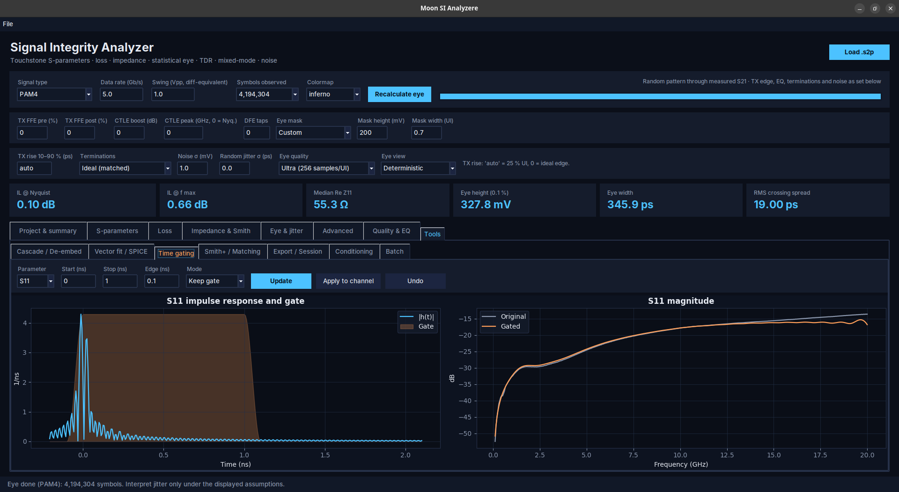
       <strong>Time gating</strong> 
      Transform a selected S-parameter into the time domain, define a gate interval and edge, then keep or remove the selected response region.
    </td>
  </tr>
  <tr>
    <td valign="top" width="50%">
      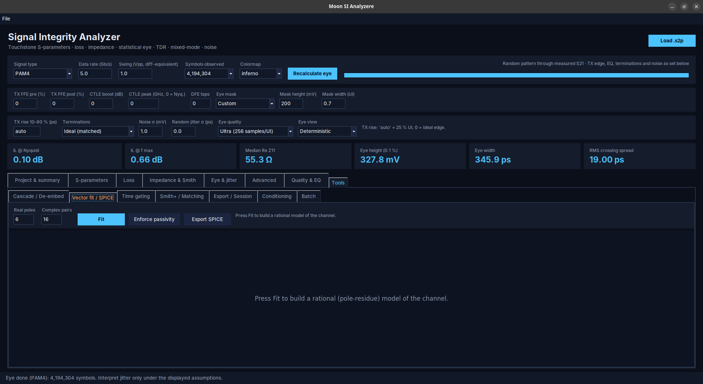
       <strong>Vector fit / SPICE</strong> 
      Fit a rational pole-residue model to the network response, inspect fit error and passivity, and export a SPICE subcircuit.
    </td>
    <td valign="top" width="50%">
      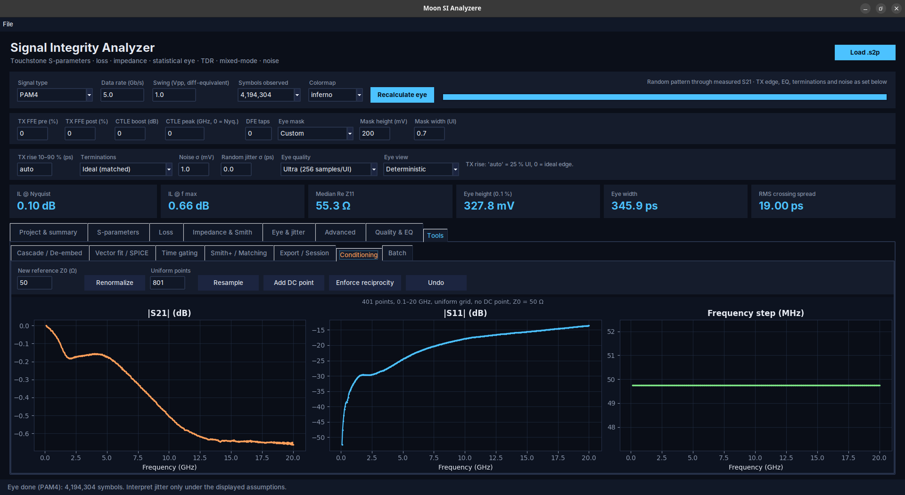
       <strong>Conditioning</strong> 
      Inspect frequency-grid spacing and channel traces, resample to a uniform grid, extrapolate a DC point, enforce reciprocity, and undo the last operation.
    </td>
  </tr>
</table>

## Download

Prebuilt applications are published through **GitHub Releases**. The current published release is **v1.0.0**.

  

| Platform | Download | Package contents |
|---|---|---|
| Windows | [Moon-SI-Analyzer-Windows.zip](https://github.com/IslamHUFE/Signal-Integrity-Analyzer/releases/download/v1.0.0/Moon-SI-Analyzer-Windows.zip) | Standalone Windows executable. Extract the ZIP and run <code>Moon SI Analyzer.exe</code>. |
| Linux | [Moon-SI-Analyzer-Linux.tar.gz](https://github.com/IslamHUFE/Signal-Integrity-Analyzer/releases/download/v1.0.0/Moon-SI-Analyzer-Linux.tar.gz) | Standalone Linux executable. Extract the archive, make the executable runnable if needed, and launch it. |
| macOS | [Moon-SI-Analyzer-macOS.zip](https://github.com/IslamHUFE/Signal-Integrity-Analyzer/releases/download/v1.0.0/Moon-SI-Analyzer-macOS.zip) | macOS application bundle. Extract the ZIP and move the <code>.app</code> to Applications if desired. |

The Windows and Linux builds use PyInstaller one-file packaging. The macOS build is distributed as an application bundle. Release assets are generated by the repository's GitHub Actions workflow.

**Platform security prompts:** The distributed binaries are not documented as code-signed or notarized. Windows SmartScreen or macOS Gatekeeper may therefore show a warning when launching a downloaded build.

## Run from source

### Requirements

- Python 3.11
- Tkinter with Tcl/Tk support
- The Python packages pinned in <code>requirements.txt</code>

The current dependency set is:

| Package | Pinned version | Role |
|---|---:|---|
| NumPy | 2.4.6 | Array operations and numerical calculations |
| SciPy | 1.17.0 | Signal processing, interpolation, and numerical routines |
| Matplotlib | 3.10.9 | Embedded plots and visualizations |
| scikit-rf | 1.9.0 | Touchstone network loading and RF network operations |

Tkinter is part of Python's standard library, but some Linux distributions package its Tcl/Tk bindings separately. On Ubuntu/Debian, install the matching Tk package if <code>python -m tkinter</code> cannot open its test window:

~~~bash
sudo apt update
sudo apt install python3-tk
~~~

### Installation

Clone the repository:

~~~bash
git clone https://github.com/IslamHUFE/Signal-Integrity-Analyzer.git
cd Signal-Integrity-Analyzer
~~~

Create and activate a virtual environment.

**Linux / macOS**

~~~bash
python3.11 -m venv .venv
source .venv/bin/activate
~~~

**Windows PowerShell**

~~~powershell
py -3.11 -m venv .venv
.venv\Scripts\Activate.ps1
~~~

Install the pinned dependencies:

~~~bash
python -m pip install --upgrade pip
python -m pip install -r requirements.txt
~~~

### Launch

Start the graphical application:

~~~bash
python si_analyzer.py
~~~

You can also pass a Touchstone file as the first command-line argument to load it after the interface starts:

~~~bash
python si_analyzer.py path/to/channel.s2p
~~~

### Basic usage

1. Launch Moon SI Analyzer.
2. Select **File → Open** or press **Ctrl+O** and choose a Touchstone file.
3. If the file has a port count that needs an explicit mapping, select the intended single-ended or differential channel.
4. Review the Project & Summary, S-parameters, Loss, Impedance & Smith, and Eye & Jitter views.
5. Configure the signal type, data rate, swing, symbol count, and equalization settings before calculating the eye.
6. Open **Advanced**, **Quality & EQ**, or **Tools** for additional analyses.
7. Export plots, CSV data, an HTML report, or a JSON session when needed.

**Plot interaction:** Double-click a plot to place a marker. Right-double-click to clear the marker.

## Architecture

The code is organized around a numerical analysis layer and a Tkinter/Matplotlib presentation layer.

- **Network data model:** <code>ChannelData</code> stores the active two-port channel, its frequency vector, S matrix, reference impedances, and optional original multi-port data.
- **Touchstone ingestion:** <code>read_touchstone()</code> loads the network through scikit-rf, validates the data, and selects the active single-ended or differential channel.
- **Numerical functions:** standalone functions implement eye generation, jitter and BER-related calculations, network parameter conversion, group delay, stability and gain metrics, time-domain transforms, mixed-mode conversion, passivity checks, RLGC extraction, and other operations.
- **Advanced analysis mixin:** <code>AdvancedTabs</code> provides the Advanced notebook views.
- **Quality and tools mixin:** <code>ExtraTabs</code> provides equalization, channel-quality, comparison, crosstalk, network-processing, vector-fitting, time-gating, and export features.
- **Application utilities mixin:** <code>UltimateTabs</code> provides file handling, preferences, port mapping, conditioning, and batch processing.
- **Main application:** <code>SIAnalyzerApp</code> combines the mixins with <code>tk.Tk</code> and builds the user interface.

The application is currently concentrated in <code>si_analyzer.py</code>; <code>requirements.txt</code> defines the pinned Python dependencies, and <code>.github/workflows/python-app.yml</code> builds the cross-platform release packages.

## Engineering assumptions and limitations

Keep the following points in mind when interpreting results:

- **Input quality matters.** Incorrect port order, reference impedance, calibration, de-embedding, or frequency units will affect every downstream result.
- **Frequency coverage matters.** Time-domain reconstruction and eye analysis depend on the supplied frequency span and sampling density. Missing low-frequency/DC data and limited high-frequency coverage can affect the reconstructed response.
- **The eye is reconstructed, not captured.** The input S-parameter file does not contain a measured digital bit stream. The application generates a synthetic symbol sequence and filters it through the channel response.
- **The eye engine is not a complete link simulator.** It does not model a standards-compliant transmitter, receiver, clock/data recovery loop, or measured BER test. Equalization and noise/jitter features use the assumptions exposed by the application.
- **BER and bathtub views are estimates.** They are derived from the calculated eye and configured noise/jitter assumptions; they are not direct BER measurements.
- **COM-like is not standards COM.** The displayed COM-like budget is a simplified application-specific metric and must not be presented as a standards-compliant COM result.
- **Validate before design sign-off.** Independently verify critical results with measurement, a trusted simulator, or an established compliance workflow before using them for production or safety-critical decisions.

## Disclaimer

Moon SI Analyzer is provided for educational, research, and engineering evaluation purposes. It is an analytical aid, not a certified design, verification, compliance, or measurement system.

- **No guarantee of accuracy:** Results depend on the quality, completeness, calibration, port mapping, reference impedance, frequency range, and other properties of the input data, as well as the assumptions and settings selected by the user. Numerical results may contain errors or may not represent the behavior of a physical device or channel.
- **Model-based estimates:** Eye diagrams are synthetically reconstructed from channel data; BER and bathtub results are estimates based on configured noise and jitter assumptions; and the COM-like metric is an application-specific approximation, not a standards-compliant COM result. These outputs are not substitutes for measured results or validated compliance analysis.
- **Independent verification required:** The user is solely responsible for reviewing and independently validating all outputs before relying on them. Verify critical results using appropriate measurements, qualified engineering review, trusted simulation tools, and applicable standards and compliance procedures.
- **No design or safety assurance:** Do not rely on this software as the sole basis for production release, regulatory approval, safety-critical systems, or any decision where an incorrect result could cause damage, injury, or loss.
- **Use at your own risk:** The authors and contributors are not responsible for losses, damages, or claims arising from the use of, or inability to use, this software, to the maximum extent permitted by applicable law.

The software is distributed **"AS IS"**, without warranties or conditions of any kind, express or implied. See the [MIT License](LICENSE) for the applicable license terms. This disclaimer does not limit any rights or liabilities that cannot legally be excluded under applicable law.

## Contributing

Contributions, bug reports, feature requests, and documentation improvements are welcome.

Please read [CONTRIBUTING.md](CONTRIBUTING.md) before opening an issue or submitting a pull request. For numerical changes, include the method and assumptions, representative Touchstone test data where shareable, and a regression test when practical.

Do not commit proprietary measurement files, private data, local environments, generated build directories, or credentials.

## License and copyright

Moon SI Analyzer is distributed under the **MIT License**. See [LICENSE](LICENSE) for the complete license text.

Copyright (c) 2026 Islam Tarek.

The MIT License permits use, modification, and redistribution subject to its terms, including preservation of the copyright and license notice. The software is provided without warranty; see the license file for the full terms.

## Project links

- **Repository:** https://github.com/IslamHUFE/Signal-Integrity-Analyzer
- **Latest release:** https://github.com/IslamHUFE/Signal-Integrity-Analyzer/releases/latest
- **Issues:** https://github.com/IslamHUFE/Signal-Integrity-Analyzer/issues
- **Contributing:** [CONTRIBUTING.md](CONTRIBUTING.md)
- **License:** [LICENSE](LICENSE)
