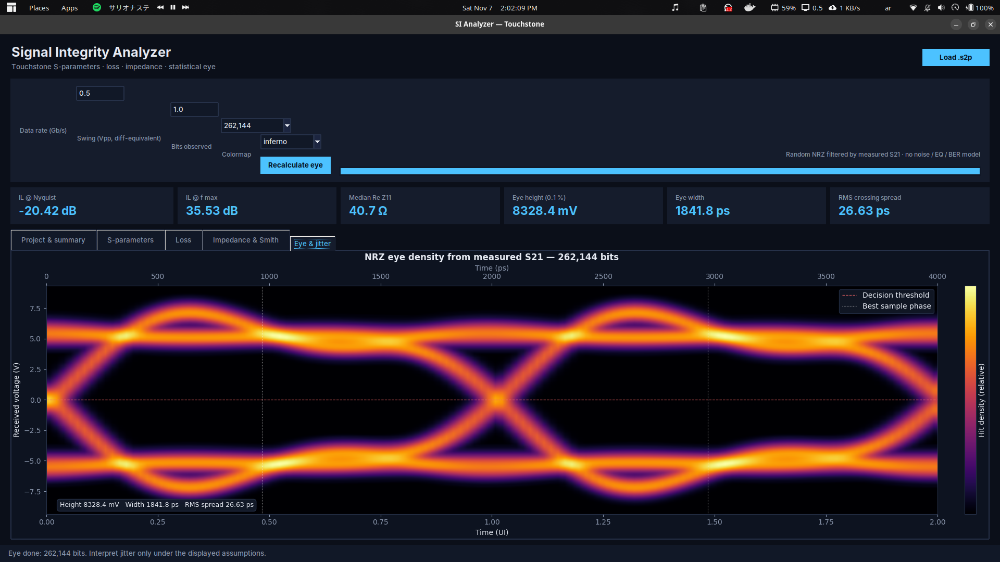
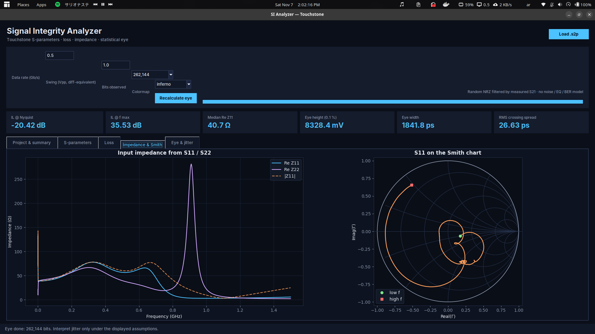
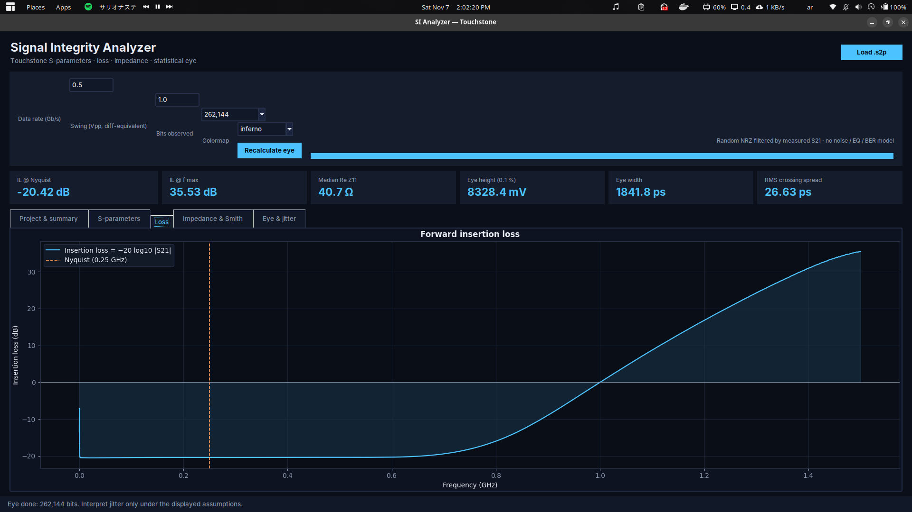
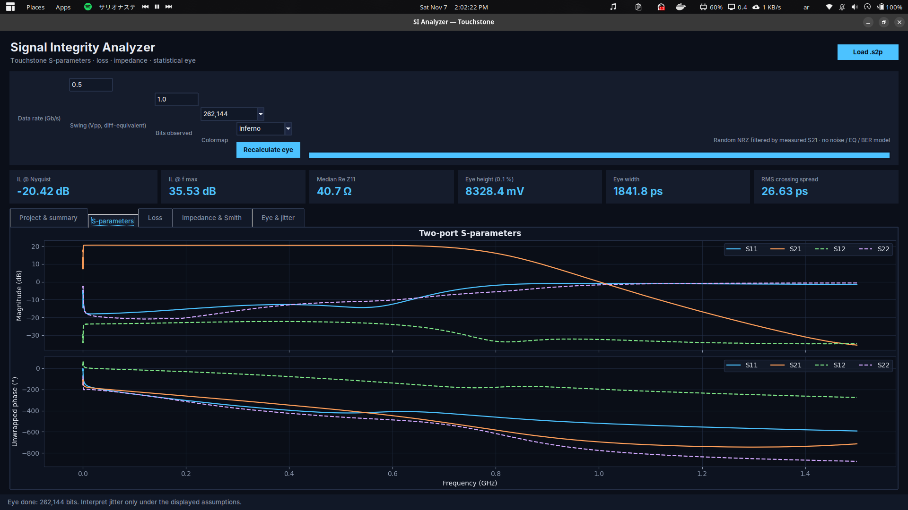

# Signal Integrity Analyzer

A Python-based signal-integrity analysis tool for inspecting two-port Touchstone (.s2p) files and visualizing their frequency-domain and time-domain behavior.

The project brings several commonly used signal-integrity views together: an NRZ eye-density diagram with jitter information, impedance versus frequency, a Smith chart, frequency-dependent loss, and S-parameter plots.

> **Project status:** This project is under active development. Results depend on the quality and frequency range of the input S-parameter data, as well as the assumptions used for time-domain reconstruction. Treat the eye and jitter results as engineering analysis aids, not as a substitute for a validated compliance test.

## Features

- **Touchstone input:** Load a two-port `.s2p` file containing measured or simulated network parameters.
- **NRZ eye-density diagram:** Visualize the reconstructed NRZ signal as an eye-density plot.
- **Jitter visualization:** Inspect the jitter information calculated by the analyzer alongside the eye diagram.
- **Impedance versus frequency:** Examine how impedance varies over the frequency sweep.
- **Smith chart:** View complex reflection-coefficient / impedance behavior on a Smith chart.
- **Frequency-dependent loss:** Inspect loss versus frequency from the network data.
- **S-parameters:** Visualize two-port reflection and transmission responses.

## Screenshots

The following screenshots show the analyzer's main visualization panels. All images are stored in the [`images/`](images/) directory.

### NRZ eye diagram and jitter

The eye-density view displays the reconstructed NRZ signal, with eye-height, eye-width, and RMS crossing-spread metrics.



### Input impedance and Smith chart

The impedance panel plots the input impedance versus frequency and shows the S11 response on a Smith chart.



### Forward insertion loss

The loss panel shows forward insertion loss across the frequency sweep, including the Nyquist-frequency marker.



### Two-port S-parameters

The S-parameter panel displays magnitude and unwrapped phase for S11, S21, S12, and S22.



## Input data

The analyzer expects a **two-port Touchstone file** with the `.s2p` extension.

For meaningful results:

1. Use a valid Touchstone file exported from your measurement instrument or simulator.
2. Check that the file contains the intended two-port network and that its frequency units and S-parameter data are correct.
3. Confirm that the frequency sweep covers the bandwidth needed for your analysis.
4. Keep the reference impedance in mind when interpreting S-parameters, impedance plots, and the Smith chart.

The plots describe the network represented by the supplied file. They cannot compensate for incorrect port definitions, calibration, de-embedding, reference impedance, or insufficient measurement/simulation bandwidth.

## Analysis views

| View | What it helps you inspect |
|---|---|
| NRZ eye density | Eye opening, waveform spread, and inter-symbol interference visible in the reconstructed signal |
| Jitter | Timing variation reported by the analyzer; interpretation depends on the implemented calculation and settings |
| Impedance vs. frequency | Frequency-dependent impedance behavior |
| Smith chart | Reflection-coefficient and impedance behavior across the frequency sweep |
| Loss vs. frequency | How transmission/reflection-related loss changes with frequency |
| S-parameters | Two-port reflection and transmission behavior |

### Important note about eye diagrams

An `.s2p` file contains frequency-domain network data; it does not contain a captured digital bit stream by itself. An eye diagram therefore depends on the analyzer's time-domain reconstruction and its assumptions (for example, excitation pattern, bit rate, edge characteristics, and other configured parameters). Record those settings when comparing results from different runs.

## Getting started

1. Clone this repository:
   ```bash
   git clone https://github.com/IslamHUFE/Signal-Integrity-Analyzer.git
   cd Signal-Integrity-Analyzer
   ```
2. Set up a Python environment appropriate for the project.
3. Install the dependencies specified by the repository's dependency file, if present.
4. Launch the application using the project's Python entry point.
5. Load a two-port `.s2p` file and inspect the generated analysis plots.

The Python source is the authoritative reference for the exact entry-point command, dependency list, and available analysis settings. These details may change as the project evolves.

## Repository structure

```text
Signal-Integrity-Analyzer/
├── images/        # Project screenshots and visual examples
├── ...            # Python source code and project files
├── README.md
└── CONTRIBUTING.md
```

## Contributing

Contributions, bug reports, feature suggestions, and documentation improvements are welcome.

Please read [CONTRIBUTING.md](CONTRIBUTING.md) before opening an issue or submitting a pull request.

## Limitations and responsible use

- Analysis quality is limited by input-file validity, frequency span, resolution, and reference impedance.
- Time-domain and eye-diagram results are model-based reconstructions from network data; they may differ from measurements on real hardware.
- Independently validate results before making production, compliance, or safety-critical design decisions.

## License

Check the repository's [LICENSE](LICENSE) file for the terms under which this project may be used, modified, and distributed. If no license file is present, all rights remain with the copyright holder by default.

## Author

**IslamHUFE**

- GitHub: [@IslamHUFE](https://github.com/IslamHUFE)
- Project: [Signal-Integrity-Analyzer](https://github.com/IslamHUFE/Signal-Integrity-Analyzer)
